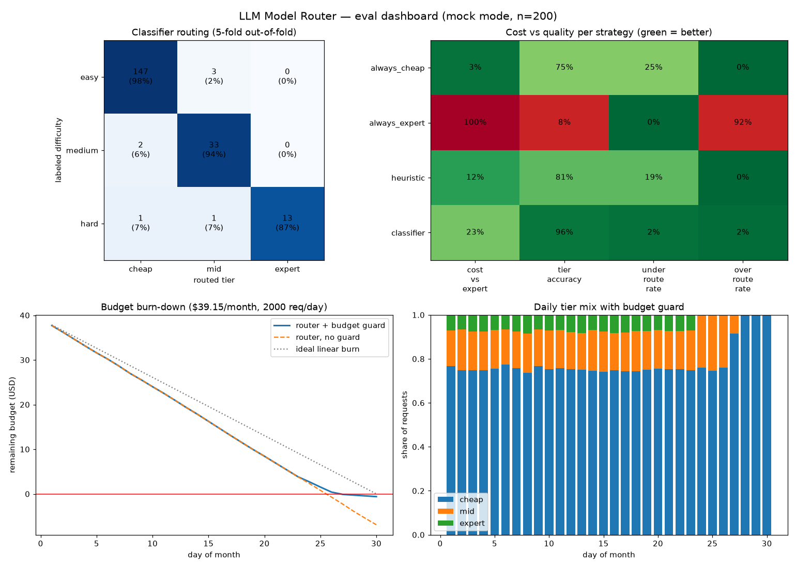
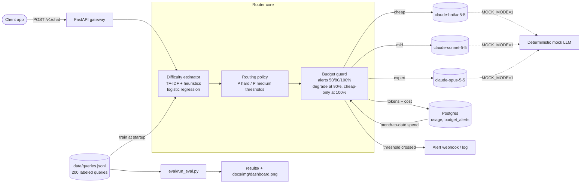

# LLM Model Router with Budgets

**Sends easy questions to a cheap model and hard ones to a strong model, and keeps total spend under a monthly budget.**

[](https://github.com/liorva22/llm-model-router/actions/workflows/ci.yml)
[](LICENSE)


## Demo



*Generated by `MOCK_MODE=1 python eval/run_eval.py`. Top left: how the classifier routed each labeled difficulty, using out-of-fold predictions. Top right: cost against routing quality for each strategy. Bottom: a simulated 30-day month at 2,000 requests/day showing the budget burn-down, plus the guard's tier mix shifting as the budget runs out.*

## The problem

Companies pay top-model prices for every request, even though most requests are simple ("What's the capital of Peru?"). Sending everything to the cheapest model saves money but gives bad answers to hard questions. This router decides per request which model is good enough, and makes sure the monthly bill can't run away.

## Architecture



1. **Estimate.** A logistic-regression classifier over TF-IDF n-grams and six hand-written features returns P(easy / medium / hard) in ~2 ms on CPU.
2. **Route.** P(hard) ≥ 0.45 goes to Opus 5.5. P(medium)+P(hard) ≥ 0.40 goes to Sonnet 5.5. Everything else goes to Haiku 5.5. The thresholds are deliberately biased upward, because under-routing hurts quality more than over-routing hurts cost.
3. **Guard the budget.** Month-to-date spend comes from Postgres. Alerts fire once per month at 50/80/100%, deduplicated by a primary key. Expert requests are downgraded to mid at 90%, and everything goes to cheap at 100%.
4. **Call and record.** The chosen model answers, and the response carries the tokens, cost, and routing decision. Each call is written to the `usage` table.

## Key results

All numbers come from `MOCK_MODE=1 python eval/run_eval.py` (full output in [`results/summary.md`](results/summary.md) and [`results/eval_results.json`](results/eval_results.json)). Classifier numbers are **5-fold out-of-fold**: each query is routed by a model that never saw it.

| Strategy | Cheap / Mid / Expert | Tier accuracy | Under-routed | Over-routed | Cost vs always-expert |
|---|---|---|---|---|---|
| always_cheap | 100% / 0% / 0% | 75.0% | 25.0% | 0.0% | 2.5% |
| always_expert | 0% / 0% / 100% | 7.5% | 0.0% | 92.5% | 100.0% |
| heuristic (no training) | 90% / 8% / 3% | 81.0% | 19.0% | 0.0% | 12.0% |
| **classifier** | **75% / 18% / 6%** | **96.5%** | **2.0%** | 1.5% | **22.6%** |

- **Routing overhead:** p50 1.87 ms, p95 4.33 ms per request (CPU, measured on the 200 out-of-fold predictions).
- **Budget month** (simulated: 2,000 req/day × 30 days through the real `Router`): always-expert $198.16, router without the guard $46.06. **The router with the guard spent $39.75 against a $39.15 budget**: degradation started on day 23, and cheap-only traffic after 100% caused a 1.5% overshoot.

**What these numbers are and aren't.**
- *Under-routed* (the routed tier is weaker than the labeled tier) is the quality proxy. It measures routing correctness, not answer quality.
- Dollar figures use real list prices multiplied by **mock token counts**. They show the price structure, not a real bill.
- The 200 queries were written and labeled by me, as a single annotator.
- Real answer-quality retention needs an API key: `python eval/run_eval.py --limit 60` grades each routed answer against Opus's answer with a Sonnet judge, and runs the LLM-judge difficulty baseline. It hasn't been run yet (no API key was available).

## Tech stack

| Component | Choice | Why |
|---|---|---|
| API gateway | FastAPI + Uvicorn | Same runtime as the scikit-learn estimator, with typed request validation. |
| Difficulty estimator | scikit-learn (TF-IDF + logistic regression) | Routes in ~2 ms, inspectable, trains in under a second. No per-request LLM fee. |
| Models | Claude Haiku 5.5 / Sonnet 5.5 / Opus 5.5 | Three price points: $0.10 / $2 / $4 per million input tokens. IDs and prices live in `config.yaml`. |
| Spend ledger | Postgres 16 (pgvector image) | Supabase-compatible schema. A primary key gives exactly-once alerts across workers. |
| Charts | matplotlib | Static PNG, rendered in CI with no browser. |
| Packaging | Docker Compose | `docker compose up` gives you the API plus a database. |

## Quickstart

```bash
git clone https://github.com/liorva22/llm-model-router && cd llm-model-router
docker compose up -d --build                        # API on :8101, MOCK_MODE=1 by default
curl -s -X POST localhost:8101/v1/chat -H 'content-type: application/json' -d '{"query":"What is the capital of Peru?"}'
curl -s localhost:8101/v1/budget
```

To use real models, put `MOCK_MODE=0` and `ANTHROPIC_API_KEY=...` in `.env` (see `.env.example`) and rerun `docker compose up -d`.

To reproduce the results locally: `pip install -e ".[dev,eval]" && MOCK_MODE=1 python eval/run_eval.py`.

## Project structure

```
router/
  app.py         FastAPI app: /v1/chat, /v1/budget, /healthz
  core.py        Router.handle(): estimate -> route -> guard -> call -> record -> alert
  difficulty.py  heuristic features, classifier, LLM-judge baseline
  policy.py      threshold routing + budget degradation
  budget.py      Postgres / in-memory ledgers, exactly-once alerts, webhook
  llm.py         Anthropic + deterministic mock providers
  config.py      config.yaml loader (model IDs, prices, thresholds)
data/queries.jsonl   200 labeled queries (150 easy / 35 medium / 15 hard)
eval/run_eval.py     strategy comparison, out-of-fold CV, budget-month simulation, dashboard
results/             committed outputs of the last eval run
docs/                architecture diagram, PITCH, DECISIONS, dashboard image
```

## Testing

```bash
pip install -e ".[dev]"
MOCK_MODE=1 pytest -q          # set DATABASE_URL to also run the Postgres ledger test
```

The tests cover heuristic ranking, the classifier routing unseen queries, threshold edges, every degradation branch, once-per-month alert semantics, month-scoped spend, and the API end to end (routing, degrading after the budget is exhausted, rejecting empty input). They also cover the Postgres ledger, including the exactly-once alert constraint. CI runs ruff, pytest against a Postgres service container, and the full eval as an integration test.

## What I learned / next steps

- **Asymmetric errors drive the design.** A misrouted easy query wastes a fraction of a cent. A misrouted hard query produces a bad answer. Biasing the thresholds upward cost about 3 points of mid-tier share and cut under-routing to 2%.
- **Hand-written heuristics alone under-route badly** (19%). They miss medium-difficulty requests phrased plainly ("Explain the CAP theorem..."). Even 200 labeled examples fixed most of that.
- **Next:** run the live quality eval and publish quality retention next to the mock numbers. Label real traffic using outcome signals. Try a cheap-first cascade with escalation. Add per-tenant budgets.

**One-page pitch:** [docs/PITCH.md](docs/PITCH.md) · **Design log:** [docs/DECISIONS.md](docs/DECISIONS.md)
